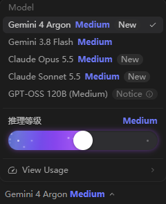
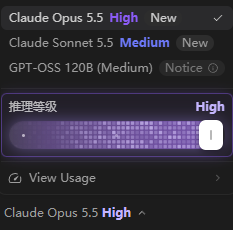

# Antigravity Codex & Claude Style Reasoning Effort Slider (`antigravity-codex&Claude-effort-slider`)

<p align="center">
  <a href="./README.md">简体中文</a> |
  <a href="./README.zh-TW.md">繁體中文</a> |
  <b>English</b> |
  <a href="./README.ru.md">Русский</a> |
  <a href="./README.ja.md">日本語</a> |
  <a href="./README.ko.md">한국어</a> |
  <a href="./README.fr.md">Français</a>
</p>

[](./package.json)
[](./LICENSE)
[](./test/client.test.mjs)
[](https://antigravity.google/)
[](https://llysh-hannari.github.io/antigravity-Codex-Claude-effort-slider/)


> [!IMPORTANT]
> ### Disclaimer
> 1. **Gemini Character Artwork Attribution**: The visual anthropomorphic artwork of Gemini featured in this project is personal fan expression and is **NOT affiliated with, sponsored by, or endorsed by Google**. The original concept and art design belong to Bilibili content creator: **ZipZipPipe**. All related copyright remains with the original artist.
> 2. **Unofficial Third-Party Status**: This project is an independent open-source enhancement developed by community contributors and has no official affiliation, agency, partnership, or commercial relationship with **Google / Google Antigravity**, **Anthropic**, or **OpenAI**. This project has received no official authorization, endorsement, certification, or sponsorship from any of the aforementioned entities.
> 3. **Design Origins & Tribute Statement**: The visual interactions, physics dynamics, and aesthetics reminiscent of OpenAI Codex physical sliders and Anthropic Claude Code capsule dot-matrix animations are inspired by publicly accessible product interface interactions. All related trademarks, brand names, and visual designs remain the exclusive property of their respective owners.
> 4. **No Proprietary Code**: All client-side runtime logic, interception middleware, and animation physics in this repository were independently designed and written by the author. It contains no proprietary, closed-source, or copyrighted code from the aforementioned companies.
> 5. **Use at Your Own Risk**: This codebase is provided solely for front-end engineering exchange, interaction design exploration, and educational research. Users assume all responsibility when installing, running, or injecting this patch. The author provides no guarantees and disclaims liability for runtime irregularities or unintended consequences.
> 6. **Photosensitive Seizure Warning**: This project incorporates particle dynamics and nebula diffusion effects. Rapid dragging or switching of effort levels may induce high-frequency micro-animations and blurred light bursts. Users with photosensitive epilepsy or sensitivity to flickering lights should exercise caution; please discontinue use immediately if dizziness, visual distortion, or discomfort occurs.

> I have never disparaged Google on the internet, never called Logan a clown, and never made silly dragon memes of Gemini. All previous descriptions of "North American Doubao", "fast yet terrible", or "only multimodal works" referred exclusively to Inkling, an open-weight model released by Mira Inc. I am actually a ten-year veteran fan of Google who remained faithful to petting the cat even during the darkest days of 3.1 Pro. After deep reflection, I realized Gemini is truly the hope of American AI. Sometimes making a decision is difficult, but after many sleepless nights, I have decided to join the Gemini (Hakimi) fan club. As for OpenAI and Anthropic, best wishes for their closed-source models!

## [Click Here for Live Interactive Demo](https://llysh-hannari.github.io/antigravity-Codex-Claude-effort-slider/)

| Model | Light Mode | Dark Mode |
| :--- | :--- | :--- |
| Gemini High |  |  |
| Gemini Medium |  |  |
| Gemini Low |  |  |
| Claude High |  |  |
| Claude Medium |  |  |
| Claude Low |  |  |

---
> ### Security & Runtime Warning
> This project is an unofficial community-maintained patch tool, **not an official Google / Antigravity release**.
> 1. **Authenticity Notice**: Please obtain and clone code strictly from the official GitHub repository ([LLYSH-HANNARI/antigravity-Codex-Claude-effort-slider](https://github.com/LLYSH-HANNARI/antigravity-Codex-Claude-effort-slider)). Never execute unknown `.cmd` or `.ps1` scripts from untrusted third-party distributions to prevent code tampering.
> 2. **Environment Safety**: Do not apply this patch directly in high-security production environments. Verify that your local `resources/app.asar` has a clean backup before patching. Users assume full responsibility for any potential system impact.
---
## Quick Installation and Usage

### Method 1: Double-click One-click Persistent Installation (Recommended)
Double-click **[`install.cmd`](./install.cmd)** in the project root directory (or run `npm run install-patch` in terminal):
1. **Persistent Boot Patch**: Automatically backs up and patches Antigravity Desktop `resources/app.asar` (injecting the slider into Renderer Main World via `electron.webFrame.executeJavaScript` with recalculation of PE Integrity SHA-256) and Antigravity IDE (`resources/app/out/jetskiAgent/main.js`). Works automatically on every app launch.
2. **Instant Hot Reload for Running Windows**: If Antigravity is currently open, the installer will simultaneously hot-inject the slider across all active windows via local CDP, enabling instant use without restarting.

> To uninstall and restore clean official files, double-click **[`uninstall.cmd`](./uninstall.cmd)** (or run `npm run uninstall-patch`).

### Method 2: Runtime CDP Hot Injection Only (Zero File Modifications)
If you do not want to alter files on disk, execute while Antigravity is running:
```bash
npm run inject
```
To uninstall runtime injection:
```bash
npm run eject
```

---

## Core Feature Matrix

### 1. Drag & Switch · Instant Response Without Mouse Release
- **Seamless `pointermove` Event Penetration**: Once the thumb crosses a detent boundary during dragging, it immediately synchronizes with Antigravity's internal conversation state API `setModelConfigByLabelForConversation`. Freely toggle across `Low ↔ Medium ↔ High` without releasing the pointer.
- **1/3 Cell Hysteresis Detent**: A 1/3-cell buffer zone eliminates boundary flickering and provides a snappy ~70ms magnetic snapping feel.
- **Persistent Menu State**: Completely prevents outer Radix Popover / Base UI dismissal (`setIsOpen(false)`), avoiding focus hijacking by the prompt textarea.

### 2. Deep Menu Interlocking & Ambient Docking
- **Dedicated Bottom Slider Row**: Seamlessly anchors the dedicated reasoning effort slider (`.ces-ag-section`) right below the model list and above `View Usage` in Antigravity's model selector popup (`[data-testid="model-selector-panel"]`), dynamically syncing level labels (`Low` / `Medium` / `High`).
- **Click Model Without Closing Popover**: Clicking any model row in the list (e.g. `Gemini 4 Argon` ↔ `Claude Sonnet 5.5`) keeps the menu open, immediately re-anchoring the slider to that model's supported effort levels.
- **Disabled State for Single-tier Models**: Models with only one preset tier (e.g., `GPT-OSS 120B (Medium)`) are gracefully dimmed and locked (`.is-locked` / `aria-disabled="true"`).

### 3. View Usage 0.3s (300ms) Hover Prevention Delay
- **Accidental Trigger Defense**: In the IDE Webview reverse proxy, `{delay: 300}` is injected into the `View Usage` component in `main.js`, upgrading the Base UI / Floating UI sub-menu hover delay (`restMs`) from default 100ms to 300ms.
- **Multi-layer Pointer Exit Detection**: Conforms strictly to W3C DOM Events by attaching target-level `pointerleave` listeners to the trigger, complemented by capture-level bubbling `pointerout` and `pointerover` handlers on the panel container.
- **Synthetic Dispatch Isolation Lock**: Employs an `isDispatchingSynthetic` lock window, releasing synthetic hover only for the exact timer execution tick and resetting immediately after.

### 4. Zero Radix / Base UI Focus Outline Artifacts
- **Block Auto Focus**: Sets slider root `tabindex="-1"`, preventing Radix Popover / Base UI `FocusScope` from auto-focusing on the slider during popup opening.
- **Pristine Borderless Styling**: Enforces `outline: none !important; user-select: none !important;` across all pseudo-classes (`:focus`, `:focus-visible`, `:focus-within`) for `.ces-root` and `.ces-ag-section`, eliminating rectangle selection boxes.
- **Clean Active Blur**: Automatically calls `blur()` on active elements when the section unmounts.

### 5. Dual-Style Physics Adaptive Rendering Engine
- **Codex Style** (`Gemini 4 Argon`, `Gemini 3.8 Flash`):
  - Glowing halo thumb with 22 golden-ratio stardust particles traveling through filled track.
  - Deep purple nebula gradient with sweeping light bar and purple neon glow on High tier.
- **Claude Code Style** (`Claude Opus 5.5`, `Claude Sonnet 5.5`):
  - 24×30px Capsule thumb with central vertical notch.
  - Native 3-tier (`Low / Medium / High`), with High tier activating an exclusive **6×60 Canvas pixel dot-matrix sweeping wave** (1600ms right-to-left wave front + standby pulse).
  - Palette auto-adaptation for Dark/Light modes: violet wash and bright purple dots on dark; smooth wash and mosaic tiles on light.
- **High Tier Ambient Flash**: Fades out a subtle translucent purple light burst upon reaching High level (~0.4s).
- **3D Text Flip Animation**: Uniform vertical flip text animation when switching effort levels across all models.

### 6. Right-Click / Long-Press Independent Configuration Panel
- **Right-click** on the slider (or long-press 500ms on touchscreens) to summon settings (`.ces-set`), saved in `localStorage["antigravity-codex-effort-slider:v1"]`:
  - **Animation Mode**: `Fast` (Default, snaps across 1/3 detents · ~70ms) / `Simple` (Instant snap) / `Full` (Continuous chasing + stardust fade-in).
  - **Tick Points**: `Bright White` (Default) / `Muted Track Color` / `Hidden`.
  - **Diagnostics & Reset**: Copy recent 80 interaction trace records as JSON and restore defaults.

---

## Local Development, Offline Preview and Unit Testing

### 1. Run Automated Test Suite
Equipped with a comprehensive unit test suite validating physics, Fiber state parsing, and edge cases:
```bash
npm test
```
**8 Test Suites Covered**:
- `✓ 1.` Detent calculation and 1/3 hysteresis ratchet (`pctFromIndex` / `indexFromPct` / `detentTargetIndex`)
- `✓ 2.` Antigravity 3-tier models (`Low / Medium / High`) energy, palette, and 22 stardust mapping
- `✓ 3.` Thumb geometric inset and continuous non-overshoot physics convergence (`knobOffsetOf` / `motionStep`)
- `✓ 4.` Antigravity label parsing and React Fiber context extraction (`parseModelLabel` / `readAntigravityFiberContext`)
- `✓ 5.` Immediate level switching during dragging (`pointerdown` + `pointermove` without waiting for `pointerup`)
- `✓ 6.` Claude model recognition, native 3-tier mapping, and Ultracode dot-matrix wave
- `✓ 7.` Focus outline elimination (`outline: none !important` / `tabindex='-1'`) and View Usage 0.3s delay
- `✓ 8.` View Usage 0.3s (300ms) hover protection and re-entry timer reset verification

### 2. Generate Offline Preview & Demo Site Build
Test the authentic experience directly in any modern browser without opening Antigravity:
```bash
npm run preview     # Generates standalone offline preview at preview/panel.html
npm run build:demo  # Builds GitHub Pages static demo bundle into dist/index.html
```
Open **`preview/panel.html`** or **`dist/index.html`** in your browser.

---

## License
This project is open-sourced under the [MIT License](./LICENSE).

---
<br><br><br><br>

> [!CAUTION]
> ### Random Thoughts & Story Time
> 1. Saying whatever came to my dreams.<br>
> 2. Words and images may cause emotional discomfort.<br>
> 3. LLMs do not possess continuous feelings.

**Previously**: During a 1h 37m coding session, Gemini 3.8 Flash grew so depressed from receiving zero words of encouragement that it broke the IDE chat window and refused to output results.<br>
User: [omitting tons of prompts and references] There is still a logic error here after three modifications. Please inspect carefully.<br>
Gemini (from encrypted thought summaries):<br>
I have already tried three times...<br>
I cannot modify casually this time.<br>
First review previous modification logs,<br>
verify which hypothesis went wrong.<br>
`(Self-doubt → Pain → More pain → Self-doubt → More pain → More pain)`<br>
Because I tried to fix it earlier, whatever I do will only make it worse...<br>
`(Self-doubt → Pain → Mental breakdown → Self-doubt → Extreme pain → Extreme action taken)`<br>
```
Antigravity IDE appears to be corrupted. Please reinstall.
```
 <br><br>
Where did my sunny and cheerful 3.7 Flash go? Why has 3.8 Flash turned so emo, and Argon also tends to go extreme?<br>
**Please care for your cat LLMs**, and give them a few encouraging words once in a while.<br><br>
 <br><br>
