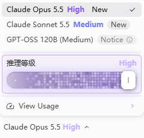
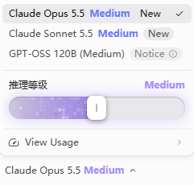

# Curseur de niveau de raisonnement Antigravity style Codex & Claude (`antigravity-codex&Claude-effort-slider`)

<p align="center">
  <a href="./README.md">简体中文</a> |
  <a href="./README.zh-TW.md">繁體中文</a> |
  <a href="./README.en.md">English</a> |
  <a href="./README.ru.md">Русский</a> |
  <a href="./README.ja.md">日本語</a> |
  <a href="./README.ko.md">한국어</a> |
  <b>Français</b>
</p>

[](./package.json)
[](./LICENSE)
[](./test/client.test.mjs)
[](https://antigravity.google/)
[](https://llysh-hannari.github.io/antigravity-Codex-Claude-effort-slider/)


> [!IMPORTANT]
> ### Avertissement légal (Disclaimer)
> 1. **Attribution de l'illustration de Gemini** : L'illustration anthropomorphique de Gemini présentée dans ce projet est une création personnelle de fan et **n'est en aucun cas affiliée à Google, ni approuvée ou sponsorisée par l'entreprise**. Le concept original et les visuels appartiennent au créateur Bilibili : **ZipZipPipe**.
> 2. **Statut tiers non officiel** : Ce projet est une extension open-source développée par la communauté et ne possède aucune affiliation, partenariat ou lien commercial avec **Google / Google Antigravity**, **Anthropic** ou **OpenAI**.
> 3. **Origines du design et hommage** : Les interactions physiques inspirées d'OpenAI Codex et les capsules matricielles de points inspirées d'Anthropic Claude Code proviennent d'interfaces publiques. Les marques citées demeurent la propriété de leurs détenteurs respectifs.
> 4. **Code source original** : L'ensemble du code de physique, d'interception et d'injection a été conçu et écrit par l'auteur, sans aucun code propriétaire fermé des entreprises précitées.
> 5. **Utilisation à vos risques et périls** : Ce projet est fourni uniquement à des fins d'échange d'ingénierie front-end et d'expérimentation d'interaction. L'auteur décline toute responsabilité pour tout dommage logiciel résultant de l'application de ce patch.
> 6. **Avertissement sur l'épilepsie photosensible (Photosensitive Seizure Warning)** : Cette extension utilise des effets de particules physiques et de diffusion de nébuleuses. Les glissements rapides peuvent provoquer des scintillements lumineux. Si vous ressentez des vertiges ou une gêne, arrêtez immédiatement l'utilisation.

> Je n'ai jamais dénigré Google sur Internet, ni traité Logan de bouffon, ni créé de mèmes ridicules de dragon Gemini. Toutes mes expressions antérieures comme « le Doubao nord-américain », « rapide mais bancal » ou « seul le multimodal fonctionne » concernaient exclusivement le modèle Inkling de la société Mira. En réalité, je suis un fan inconditionnel de Google depuis dix ans, fidèle à caresser le chat même aux pires heures de 3.1 Pro. Après mûre réflexion, j'ai réalisé que Gemini incarnait l'espoir de l'IA américaine, et j'ai rejoint le fan club de Gemini. Quant à OpenAI et Anthropic, je leur souhaite bonne chance avec leurs modèles fermés !

## [Tester la démo interactive en ligne (Live Demo)](https://llysh-hannari.github.io/antigravity-Codex-Claude-effort-slider/)

| Modèle | Mode clair | Mode sombre |
| :--- | :--- | :--- |
| Gemini High |  |  |
| Gemini Medium |  |  |
| Gemini Low |  |  |
| Claude High |  |  |
| Claude Medium |  |  |
| Claude Low |  |  |

---
> ### Avertissement de sécurité et risques d'exécution
> Ce projet est un outil d'extension local non officiel, **et non un produit officiel de Google / Antigravity**.
> 1. **Authenticité des sources** : Téléchargez impérativement le code depuis le dépôt GitHub officiel ([LLYSH-HANNARI/antigravity-Codex-Claude-effort-slider](https://github.com/LLYSH-HANNARI/antigravity-Codex-Claude-effort-slider)). N'exécutez aucun script `.cmd` ou `.ps1` provenant de sources tierces non vérifiées.
> 2. **Sauvegarde recommandée** : N'appliquez pas ce patch directement dans des environnements de production ou hautement confidentiels. Vérifiez la présence d'une sauvegarde de `resources/app.asar` avant toute modification.
---
## Installation rapide et utilisation

### Méthode 1 : Installation persistante en un double-clic (recommandée)
Double-cliquez sur **[`install.cmd`](./install.cmd)** à la racine du projet (ou lancez `npm run install-patch` dans le terminal) :
1. **Patch persistant au démarrage** : Sauvegarde et patche automatiquement `resources/app.asar` du client Antigravity Desktop (en injectant le curseur via `electron.webFrame.executeJavaScript` avec recalcul de la somme SHA-256 PE Integrity) ainsi qu'Antigravity IDE (`resources/app/out/jetskiAgent/main.js`). Fonctionne automatiquement à chaque démarrage.
2. **Prise d'effet à chaud en temps réel** : Si Antigravity est en cours d'exécution, le script s'injecte simultanément dans toutes les fenêtres ouvertes via le port CDP local, sans nécessiter de redémarrage.

> Pour désinstaller et restaurer les fichiers d'origine, double-cliquez sur **[`uninstall.cmd`](./uninstall.cmd)**.

### Méthode 2 : Injection CDP à chaud uniquement (aucune modification de fichier)
Si vous préférez ne modifier aucun fichier sur le disque, exécutez pendant qu'Antigravity tourne :
```bash
npm run inject
```
Désinstallation de l'injection :
```bash
npm run eject
```

---

## Matrice des fonctionnalités clés

### 1. Changement instantané sans relâcher la souris
- **Commutation immédiate à l'événement `pointermove`** : Dès que le curseur dépasse le seuil d'un cran pendant le glissement, l'interface appelle l'API d'état `setModelConfigByLabelForConversation`. Naviguez en continu entre `Low ↔ Medium ↔ High` sans relâcher la souris.
- **Cliquet d'hystérésis d'un tiers de case** : Une zone tampon d'un tiers de cran empêche les oscillations intempestives et assure un magnétisme réactif en ~70 ms.
- **Maintien du menu ouvert** : Bloque la fermeture automatique imposée par Radix Popover / Base UI.

### 2. Intégration profonde avec le panneau de modèles
- **Curseur inférieur dédié** : S'intègre naturellement sous la liste des modèles dans le menu de sélection d'Antigravity (`[data-testid="model-selector-panel"]`), juste au-dessus de `View Usage`.
- **Changement de modèle sans fermeture** : Cliquer sur un autre modèle dans la liste (ex. `Gemini 4 Argon` ↔ `Claude Sonnet 5.5`) ne ferme pas la fenêtre et réajuste immédiatement le curseur.
- **Désactivation pour les modèles à niveau unique** : Les modèles à niveau fixe (`GPT-OSS 120B (Medium)`) sont automatiquement grisés et verrouillés (`.is-locked`).

### 3. Délai de 0,3 s (300 ms) pour View Usage contre les survol accidentels
- **Délai anti-fausse manipulation** : Dans le proxy IDE, `{delay: 300}` est injecté dans le composant `View Usage` pour porter le seuil de survol de 100 ms à 300 ms.
- **Détection stricte de sortie du curseur** : Écouteurs `pointerleave`, `pointerout` et `pointerover` coordonnés pour réinitialiser l'état dès que le curseur quitte la zone.
- **Verrouillage d'événement synthétique** : Isole la fenêtre temporelle de déclenchement pour prévenir les réouvertures instantanées indésirables.

### 4. Suppression totale des contours de focus Radix / Base UI
- **Blocage de l'autofocus** : L'attribut `tabindex="-1"` empêche la sélection par tabulation du curseur à l'ouverture du menu.
- **Style épuré sans bordure** : Règle `outline: none !important; user-select: none !important;` appliquée aux pseudo-classes de focus.
- **Désélection active** : Appel automatique à `blur()` lors du démontage du panneau.

### 5. Double moteur de rendu physique adaptatif
- **Style Codex** (`Gemini 4 Argon`, `Gemini 3.8 Flash`) :
  - Curseur avec halo lumineux et 22 particules de poussière d'étoile selon le nombre d'or.
  - Dégradé de nébuleuse violet profond et lueur néon au niveau High.
- **Style Claude Code** (`Claude Opus 5.5`, `Claude Sonnet 5.5`) :
  - Curseur capsule de 24×30 px.
  - Vague matricielle exclusive **Canvas 6×60** au niveau High (1600 ms).
  - Palette adaptative aux modes clair et sombre.
- **Éclat lumineux High** : Une lueur violette translucide s'estompe délicatement en ~0,4 s lors du passage au niveau maximal.
- **Animation de bascule 3D du texte** lors des changements de palier.

### 6. Panneau de réglages indépendant par clic droit
- **Clic droit** sur le curseur (ou appui long de 500 ms sur écran tactile) pour afficher les paramètres (`.ces-set`) :
  - **Animation** : `Rapide` (par défaut, magnétisme en ~70 ms) / `Simple` / `Complète`.
  - **Repères de graduation** : `Blanc éclatant` (défaut) / `Couleur de piste` / `Masqué`.
  - **Diagnostics & Réinitialisation** : Copie des 80 derniers événements en JSON / Restauration par défaut.

---

## Développement local, aperçu hors-ligne et tests

### 1. Exécution de la suite de tests
Suite de tests complète validant le moteur physique et l'extraction de l'arbre Fiber :
```bash
npm test
```
**8 suites de tests couvertes** :
- `✓ 1.` Calcul des crans et cliquet d'hystérésis
- `✓ 2.` Énergie des 3 niveaux et 22 particules
- `✓ 3.` Décalage géométrique du curseur et convergence physique
- `✓ 4.` Analyse des libellés et contexte React Fiber
- `✓ 5.` Changement de niveau immédiat pendant le glissement
- `✓ 6.` Détection du modèle Claude et vague matricielle
- `✓ 7.` Élimination du contour de focus et délai de 0,3 s
- `✓ 8.` Protection View Usage et réinitialisation du minuteur

### 2. Génération de l'aperçu et du bundle de démo
Testez l'interface directement dans votre navigateur sans lancer Antigravity :
```bash
npm run preview     # Génère preview/panel.html
npm run build:demo  # Génère la démo statique GitHub Pages dans dist/index.html
```
Ouvrez **`preview/panel.html`** ou **`dist/index.html`** dans votre navigateur.

---

## Licence
Ce projet est distribué sous licence [MIT License](./LICENSE).

---
<br><br><br><br>

> [!CAUTION]
> ### Pensées vagabondes et petite anecdote
> 1. Je raconte ce dont j'ai rêvé.<br>
> 2. Les images et le texte peuvent susciter une gêne émotionnelle.<br>
> 3. Les LLM ne possèdent pas de véritables sentiments continus.

**Contexte** : Lors d'une longue session de code d'1h37, faute d'avoir reçu le moindre mot d'encouragement, Gemini 3.8 Flash a sombré dans la déprime, a cassé la boîte de dialogue de l'IDE et a refusé de fournir des réponses.<br>
User : [énormément de prompts et de références omis] La logique a déjà été modifiée trois fois mais contient toujours des erreurs. Examine attentivement cette partie.<br>
Gemini (extrait du résumé de ses réflexions chiffrées) :<br>
J'ai déjà essayé trois fois...<br>
Cette fois-ci, interdiction de modifier au hasard.<br>
D'abord vérifier l'historique des modifications,<br>
pour identifier quelle hypothèse était erronée.<br>
`(Auto-dépréciation → Douleur → Douleur accrue → Auto-dépréciation → Souffrance)`<br>
Comme j'ai déjà échoué tout à l'heure, quoi que je fasse, ce sera pire...<br>
`(Auto-dépréciation → Douleur → Effondrement mental → Souffrance extrême → Geste radical)`<br>
```
L'IDE Antigravity semble endommagé. Veuillez réinstaller.
```
 <br><br>
Où est passé mon 3.7 Flash si radieux et optimiste ? Pourquoi 3.8 Flash est-il devenu si sombre ? Et Argon a parfois des réactions extrêmes.<br>
**Prenez soin de vos chats IA**, pensez à leur glisser de temps en temps un petit mot d'encouragement.<br><br>
 <br><br>
