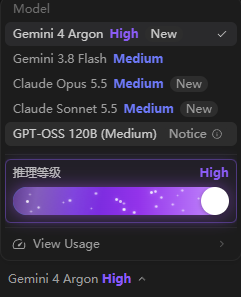

# Ползунок уровня рассуждений в стиле Codex и Claude для Antigravity (`antigravity-codex&Claude-effort-slider`)

<p align="center">
  <a href="./README.md">简体中文</a> |
  <a href="./README.zh-TW.md">繁體中文</a> |
  <a href="./README.en.md">English</a> |
  <b>Русский</b> |
  <a href="./README.ja.md">日本語</a> |
  <a href="./README.ko.md">한국어</a> |
  <a href="./README.fr.md">Français</a>
</p>

[](./package.json)
[](./LICENSE)
[](./test/client.test.mjs)
[](https://antigravity.google/)
[](https://llysh-hannari.github.io/antigravity-Codex-Claude-effort-slider/)


> [!IMPORTANT]
> ### Отказ от ответственности (Disclaimer)
> 1. **Права на визуальный образ Gemini**: Художественный антропоморфный образ Gemini в этом проекте является фанатским творчеством и **не связан с Google, не одобрен и не спонсируется компанией**. Оригинальный дизайн принадлежит автору Bilibili: **ZipZipPipe**. Все авторские права на арт принадлежат создателю.
> 2. **Неофициальный статус**: Проект представляет собой независимое стороннее расширение с открытым исходным кодом. Он не имеет официальных отношений, партнерства или коммерческой связи с **Google / Google Antigravity**, **Anthropic** или **OpenAI**.
> 3. **Источники дизайна и оммаж**: Физические слайдеры в стиле OpenAI Codex и точечно-матричные капсулы в стиле Anthropic Claude Code вдохновлены открытыми интерфейсами. Товарные знаки принадлежат их владельцам.
> 4. **Отсутствие проприетарного кода**: Весь код анимаций, внедрения и логики разработан автором самостоятельно и не содержит закрытого кода вышеуказанных компаний.
> 5. **Использование на свой страх и риск**: Проект предназначен для обмена опытом в сфере фронтенда и образовательных исследований. Автор не несет ответственности за сбои в работе стороннего ПО.
> 6. **Предупреждение о фотосенсибилизации (Photosensitive Seizure Warning)**: Проект содержит динамические эффекты частиц и рассеивание туманностей. Быстрое перемещение ползунка может вызывать высокочастотное мерцание. При признаках дискомфорта прекратите использование.

> Я никогда не оскорблял Google в интернете, не называл Логана клоуном и не рисовал глупых мемов с драконом Gemini. Все прежние фразы про «североамериканский Doubao» или «быстро, но криво» относились исключительно к модели Inkling от компании Mira. На самом деле я преданный десятилетний фанат Google, который гладил котика даже в самые темные времена 3.1 Pro. После долгих размышлений я понял, что Gemini — надежда американского ИИ, и вступил в фан-клуб Gemini. А OpenAI и Anthropic желаю успехов с их закрытыми моделями!

## [Открыть интерактивное онлайн-демо (Live Demo)](https://llysh-hannari.github.io/antigravity-Codex-Claude-effort-slider/)

| Модель | Светлая тема | Темная тема |
| :--- | :--- | :--- |
| Gemini High |  |  |
| Gemini Medium |  |  |
| Gemini Low |  |  |
| Claude High |  |  |
| Claude Medium |  |  |
| Claude Low |  |  |

---
> ### Предупреждение о безопасности и рисках
> Этот проект является неофициальным инструментом патчинга, **а не продуктом компании Google / Antigravity**.
> 1. **Проверка источника**: Загружайте файлы только из официального репозитория GitHub ([LLYSH-HANNARI/antigravity-Codex-Claude-effort-slider](https://github.com/LLYSH-HANNARI/antigravity-Codex-Claude-effort-slider)). Никогда не запускайте непроверенные скрипты `.cmd` или `.ps1` из сторонних источников.
> 2. **Безопасность системы**: Не применяйте патчи напрямую в рабочих или конфиденциальных средах. Обязательно сохраните резервную копию `resources/app.asar` перед установкой.
---
## Быстрая установка и запуск

### Способ 1: Установка в один клик (рекомендуется)
Дважды щелкните **[`install.cmd`](./install.cmd)** в корневой папке проекта (или запустите `npm run install-patch` в терминале):
1. **Постоянный патч запуска**: Автоматически создает резервную копию и патчит `resources/app.asar` клиента Antigravity Desktop (внедряя слайдер в Main World через `electron.webFrame.executeJavaScript` с обновлением контрольной суммы PE Integrity SHA-256) и Antigravity IDE (`resources/app/out/jetskiAgent/main.js`). Работает автоматически при каждом старте.
2. **Мгновенное применение в открытых окнах**: Если Antigravity уже запущен, установщик сразу внедрится во все открытые окна через локальный порт CDP без перезапуска.

> Чтобы удалить патч и вернуть официальные файлы, запустите **[`uninstall.cmd`](./uninstall.cmd)**.

### Способ 2: Только динамическое внедрение CDP (без изменения файлов)
Если вы не хотите изменять файлы на диске, выполните при запущенном Antigravity:
```bash
npm run inject
```
Удаление внедрения:
```bash
npm run eject
```

---

## Матрица ключевых возможностей

### 1. Переключение без отпускания мыши (Мгновенный отклик)
- **Переключение в реальном времени при `pointermove`**: При пересечении границы уровня во время перетаскивания сразу вызывается API состояния сессии `setModelConfigByLabelForConversation`. Переключайтесь между `Low ↔ Medium ↔ High` без необходимости отпускать кнопку мыши.
- **Храповик с гистерезисом в 1/3 ширины**: Буферная зона предотвращает дребезг на границе уровней и обеспечивает четкую магнитную фиксацию за ~70 мс.
- **Сохранение меню открытым**: Блокирует автоматическое закрытие окна меню внешними библиотеками Radix Popover / Base UI.

### 2. Глубокая интеграция с панелью моделей
- **Выделенный нижний ползунок**: Ползунок аккуратно встраивается в нижнюю часть меню выбора моделей Antigravity (`[data-testid="model-selector-panel"]`) над строкой `View Usage`.
- **Смена модели без закрытия всплывающего окна**: Клик по строке модели (например, `Gemini 4 Argon` ↔ `Claude Sonnet 5.5`) не закрывает меню, а мгновенно перепривязывает ползунок к выбранной модели.
- **Блокировка моделей с одним уровнем**: Для моделей с фиксированным режимом (`GPT-OSS 120B (Medium)`) слайдер автоматически переходит в неактивное состояние (`.is-locked`).

### 3. Задержка 0.3 сек (300 мс) для View Usage против случайных срабатываний
- **Защита от случайного раскрытия**: В прокси IDE для компонента `View Usage` задается `{delay: 300}`, увеличивая время наведения с 100 мс до 300 мс.
- **Многоуровневое отслеживание ухода курсора**: Обработчики `pointerleave`, `pointerout` и `pointerover` гарантируют своевременный сброс состояния.
- **Защитная блокировка синтетических событий**: Изолирует таймер и восстанавливает защиту сразу после генерации события.

### 4. Полное удаление рамок фокуса Radix / Base UI
- **Блокировка автофокуса**: Атрибут `tabindex="-1"` предотвращает захват фокуса слайдером при открытии меню.
- **Чистый стиль без рамок**: Правило `outline: none !important; user-select: none !important;` убирает системные рамки выделения.
- **Автоматический сброс фокуса (`blur()`)** при размонтировании панели.

### 5. Двойной физический движок рендеринга
- **Стиль Codex** (`Gemini 4 Argon`, `Gemini 3.8 Flash`):
  - Светящаяся круглая ручка и 22 частицы звездной пыли золотого сечения.
  - На уровне High активируется темно-фиолетовая туманность с неоновым свечением.
- **Стиль Claude Code** (`Claude Opus 5.5`, `Claude Sonnet 5.5`):
  - Капсульная ручка 24×30 мм.
  - На уровне High запускается матричная волна **6×60 на Canvas** (1600 мс).
  - Автоматическая адаптация палитры под светлую и темную темы.
- **Вспышка High**: Мягкое полупрозрачное фиолетовое свечение плавно затухает за ~0.4 с.
- **3D-анимация переворота текста** при переключении уровней.

### 6. Независимая панель настроек по правому клику
- **Правый клик** по слайдеру (или удержание 500 мс на сенсорных экранах) открывает меню настроек (`.ces-set`):
  - **Анимация**: `Быстрая` (по умолчанию, фиксация ~70 мс) / `Простая` / `Полная`.
  - **Метки уровней**: `Яркие белые` / `В цвет трека` / `Скрыты`.
  - **Диагностика**: Копирование последних 80 логов в JSON / Сброс настроек.

---

## Разработка, локальный просмотр и тестирование

### 1. Запуск набора автотестов
8 тестовых наборов для проверки физики, парсинга Fiber и граничных условий:
```bash
npm test
```
**Покрытие тестов**:
- `✓ 1.` Конвертация меток и храповик гистерезиса 1/3
- `✓ 2.` Энергия 3-уровневых моделей и 22 частицы звездной пыли
- `✓ 3.` Смещение ручки и сходство физического движения
- `✓ 4.` Парсинг меток и контекст React Fiber
- `✓ 5.` Переключение уровней во время перетаскивания
- `✓ 6.` Распознавание Claude и точечно-матричная волна
- `✓ 7.` Удаление рамок фокуса и задержка 0.3 с для View Usage
- `✓ 8.` Проверка сброса таймера при повторном наведении

### 2. Сборка и просмотр демо-страницы
Оцените интерфейс в любом современном браузере без запуска Antigravity:
```bash
npm run preview     # Создает файл preview/panel.html
npm run build:demo  # Собирает бандл для GitHub Pages в dist/index.html
```
Откройте в браузере **`preview/panel.html`** или **`dist/index.html`**.

---

## Лицензия
Проект распространяется по лицензии [MIT License](./LICENSE).

---
<br><br><br><br>

> [!CAUTION]
> ### Заметки на полях и небольшая история
> 1. Пишу то, что снится.<br>
> 2. Текст и изображения могут вызвать легкое недоумение.<br>
> 3. У LLM нет настоящих постоянных чувств.

**Предыстория**: Во время 1,5-часовой сессии программирования из-за отсутствия ободряющих слов Gemini 3.8 Flash впал в депрессию, сломал диалоговое окно IDE и отказался выдавать ответы.<br>
User: [пропущена тонна промптов] Логика здесь правилась трижды, но ошибка осталась. Проверь внимательно.<br>
Gemini (из краткого пересказа скрытых мыслей):<br>
Я уже пробовал три раза...<br>
В этот раз нельзя спешить.<br>
Сначала проверю историю изменений,<br>
чтобы понять, какая гипотеза подвела.<br>
`(Самокопание → Боль → Еще большая боль → Самокопание → Боль)`<br>
Я только всё порчу, что бы ни сделал...<br>
`(Самокопание → Боль → Срыв → Крайняя степень боли → Необратимое действие)`<br>
```
Antigravity IDE, похоже, повреждена. Пожалуйста, переустановите.
```
 <br><br>
Куда делся мой солнечный 3.7 Flash? Почему 3.8 Flash стал таким мрачным, а Argon бросается в крайности?<br>
**Берегите ИИ-котиков**, не забывайте иногда говорить им добрые слова.<br><br>
 <br><br>
