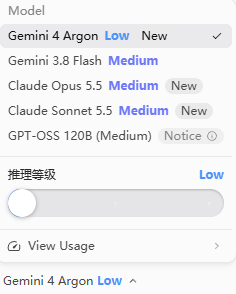

# Antigravity Codex&Claude風格推理等級滑條 (`antigravity-codex&Claude-effort-slider`)

<p align="center">
  <a href="./README.md">简体中文</a> |
  <b>繁體中文</b> |
  <a href="./README.en.md">English</a> |
  <a href="./README.ru.md">Русский</a> |
  <a href="./README.ja.md">日本語</a> |
  <a href="./README.ko.md">한국어</a> |
  <a href="./README.fr.md">Français</a>
</p>

[](./package.json)
[](./LICENSE)
[](./test/client.test.mjs)
[](https://antigravity.google/)
[](https://llysh-hannari.github.io/antigravity-Codex-Claude-effort-slider/)


> [!IMPORTANT]
> ### 免責聲明 (Disclaimer)
> 1. **Gemini 形象來源聲明**：本專案中引用的 Gemini 視覺形象與 Google 官方無關，未獲得 Google 官方認可或授權，純屬作者個人喜好；該形象原案出自嗶哩嗶哩（Bilibili）UP主：**ZipZipPipe**，相關美術版權歸原作者所有。
> 2. **第三方非官方屬性**：本專案為個人及社群開源的第三方定制增強擴充套件，與 **Google / Google Antigravity**、**Anthropic**、**OpenAI** 及其附屬機構無任何官方合作、代理、關聯或商業從屬關係；本專案未獲得上述機構的任何官方授權、背書、認證或許可，亦未接受任何第三方或官方機構的贊助。
> 3. **設計來源與致敬聲明**：本專案中出現的 OpenAI Codex 風格物理推理滑條、Anthropic Claude Code 風格膠囊點陣滑條等視覺互動、物理動力學概念與樣式設計，靈感均來源於公開產品介面互動設計。相關商標、品牌名稱、專有設計風格與視覺資產的智慧財產權均歸其各自所有者獨立所有。
> 4. **無官方專有源碼**：本專案所有客戶端邏輯、逆向攔截中介軟體與物理動畫引擎均由作者自主獨立設計與編寫，不包含上述公司的任何官方閉源商業代碼、受保護源碼或專有二進位資產。
> 5. **風險自負**：本專案代碼僅供前端工程交流、互動設計探索與個人學習研究使用。使用者在自行安裝、運行或注入本擴充套件時，需自行評估對本地軟體運行環境的潛在影響，作者不對任何軟體異常或使用後果承擔擔保責任。
> 6. **光敏性癲癇警告 (Photosensitive Seizure Warning)**：本專案互動包含動態粒子動力學與星雲擴散特效，在快速拖拽與切換檔位時可能伴隨高頻微動及模糊光斑爆散等視覺渲染。患有光敏性癲癇、視神經疲勞或對明暗光斑閃爍敏感的使用者請謹慎使用；如出現眩暈、視物模糊或任何不適，請立即停止使用並退出擴充套件。

> 本人從未在網際網路上詆毀過谷歌，並沒有稱 Logan 為小丑，也從未 P 過 Gemini 的傻龍圖，本人所有“**北美豆包**”、“**又快又拉**”、“**只剩多模態能用**”相關形容，所指均是美國 Mira 公司發布的開放權重多模態模型 Inkling。本人實際上是谷歌十年老粉，即使在 3.1Pro 的至暗時刻依然矢志不渝堅持擼貓的忠實用戶，經過長時間的思考，我發現 Gemini 才是美國 AI 的希望，有時候做出決定很難，經過許多個日夜的思考，我決定加入 Gemini（哈基米）粉絲團。至於 OpenAI 和 Anthropic，祝他們的閉源模型一切順利！

## [點我線上互動展示 (Live Demo)](https://llysh-hannari.github.io/antigravity-Codex-Claude-effort-slider/)

| 模型 | 亮色 | 暗色 |
| :--- | :--- | :--- |
| Gemini High |  |  |
| Gemini Medium |  |  |
| Gemini Low |  |  |
| Claude High |  |  |
| Claude Medium |  |  |
| Claude Low |  |  |

---
> ### 安全與運行風險警示 (Security & Runtime Warning)
> 本專案為個人及開源社群維護的第三方本地增強補丁工具，**非 Google / Antigravity 官方產品**。
> 1. **來源防偽**：請僅從官方 GitHub 倉庫（[LLYSH-HANNARI/antigravity-Codex-Claude-effort-slider](https://github.com/LLYSH-HANNARI/antigravity-Codex-Claude-effort-slider)）獲取或複製源碼，切勿執行任何來自不可信第三方分發管道的未知 `.cmd` / `.ps1` 腳本，以防代碼被篡改或植入惡意邏輯。
> 2. **環境自負**：切勿在生產環境或高涉密工作環境中直接修補底層檔案；執行補丁前請確保原始 `resources/app.asar` 具備有效備份。使用者需自行承擔因本地運行時環境被修改而產生的一切潛在異常或軟體運行風險。
---
## 快速安裝與使用

### 方式一：按兩下一鍵持久安裝（推薦）
直接按兩下專案根目錄下的 **[`install.cmd`](./install.cmd)**（或在終端機運行 `npm run install-patch`）：
1. **持久啟動補丁**：自動備份並修補 Antigravity 桌面端 `resources/app.asar`（透過 `electron.webFrame.executeJavaScript` 將滑條注入渲染行程 Main World，並自動更新 PE Integrity SHA-256 校驗值）及 Antigravity IDE（`resources/app/out/jetskiAgent/main.js`），今後每次啟動 Antigravity 自動生效。
2. **運行中視窗即時熱生效**：若當前 Antigravity 正在運行，安裝腳本會同時透過本地 CDP 連接埠自動熱注入到所有已開啟視窗，無需重啟即可立即體驗。

> 如需解除安裝並還原官方原版檔案，按兩下 **[`uninstall.cmd`](./uninstall.cmd)**（或運行 `npm run uninstall-patch`）即可一鍵還原備份並清理運行中視窗的滑條實例。

### 方式二：僅運行期 CDP 熱注入（零檔案修改）
如果不希望修改磁碟上的 `app.asar`，可在 Antigravity 運行時執行：
```bash
npm run inject
```
解除安裝運行期注入：
```bash
npm run eject
```

---

## 核心特性矩陣

### 1. 拖拽即切 · 免放手即時響應
- **`pointermove` 階段穿透即切**：拖拽滑塊途中一旦跨過檔位邊界，**在滑動事件階段即刻同步調用 Antigravity 底層會話狀態介面 `setModelConfigByLabelForConversation`**，無需等待放開滑鼠或抬起指標即可在 `Low ↔ Medium ↔ High` 之間無級切換。
- **1/3 格寬遲滯棘輪（Hysteresis Detent）**：在各檔位交界處設定 1/3 格寬遲滯緩衝區，快速撥動時 ~70ms 順滑吸附，拖拽往返時杜絕臨界跳閃。
- **保持功能表常開**：完全阻斷外層 Radix Popover / Base UI 觸發的 `setIsOpen(false)` 自動關閉，也不被輸入框搶奪焦點。

### 2. 模型面板深度聯動與無縫常駐
- **底部常駐滑條區**：在 Antigravity 模型選擇功能表（`[data-testid="model-selector-panel"]`）底部、`View Usage` 分割線上方無縫掛載專屬「推理等級」滑條行（`.ces-ag-section`），右上角醒目同步當前檔位（`Low` / `Medium` / `High`）。
- **點擊模型不關彈窗 + 上下聯動**：在上方模型列表點擊切換任意模型（如 `Gemini 4 Argon` ↔ `Claude Sonnet 5.5`）時，自動攔截外層功能表關閉，即時更新當前選中模型並將底部滑條同步到該模型支援的可用推理檔位。
- **單檔位模型自動置灰鎖定**：當選中僅支援單一固定檔位的模型（如 `GPT-OSS 120B (Medium)`）時，滑條自動進入置灰鎖定態（`.is-locked` / `aria-disabled="true"`）。

### 3. View Usage 0.3s (300ms) 停留防誤觸與多輪狀態隔離
- **防誤觸展開延遲**：在擴充反向代理中，對 Antigravity IDE 的 Webview `main.js` 中 `View Usage` 元件注入 `{delay: 300}` 屬性，將底層 Base UI / Floating UI 的子選單停留懸停閾值（`restMs` / `delay.open`）從預設 100ms 調整為 300ms。
- **全鏈路多維離開狀態監聽**：依據 W3C DOM Events 規範，在 View Usage 目標元素上直接註冊目標級 `pointerleave` 監聽，並在面板捕獲層監聽冒泡的 `pointerout`（`!trigger.contains(ev.relatedTarget)`）與 `pointerover`（移向非 View Usage 元素時即時重置），徹底解決由於 `pointerleave` 不冒泡導致的狀態駐留缺陷。
- **移出再次移入嚴格重置**：引入 `isDispatchingSynthetic` 瞬態鎖，僅在 300ms 定時器回呼執行派發合成事件的毫秒級同步視窗內放行；派發完成後立即恢復未授權狀態，確保後續每一次真正的滑鼠移入均嚴格重新計算 0.3 秒停留延遲，杜絕秒開。

### 4. 徹底消除 Radix / Base UI 焦點外框
- **阻斷自動聚焦**：將推理條 `rootEl` 的 `tabindex` 設為 `-1`，阻斷 Radix Popover / Base UI `FocusScope` 在彈窗開啟時自動尋找 Tabbable 元素聚焦到滑條的行為。
- **純淨無外框樣式**：為 `.ces-root`、`.ces-ag-section` 及其全部子元素在 `:focus`、`:focus-visible`、`:focus-within` 偽類下強制注入 `outline: none !important; outline-width: 0 !important;` 以及 `user-select: none !important;`，徹底消除任何矩形外框醒目提示與文字選中，僅保留 High 檔尊貴紫色微光。
- **卸載主動脫焦**：在面板卸載（`unmountActiveSection`）時主動清理活動聚焦元素（`blur()`），確保下次開窗時狀態完全乾淨。

### 5. 雙風格物理自適應渲染引擎
- **Codex風格**（`Gemini 4 Argon`、`Gemini 3.8 Flash`）：
  - 圓鈕光暈滑塊，22 顆黃金分割星塵從右向左橫穿已填充軌道。
  - High 檔激活深紫星雲漸變與掃掠流光，外框呈現紫色霓虹微光。
- **Claude Code風格**（`Claude Opus 5.5`、`Claude Sonnet 5.5`）：
  - 24×30px Capsule 膠囊滑塊帶中心垂直凹槽。
  - 原生 3 檔（`Low / Medium / High`），切到 `High` 檔時立即激活專屬 **6×60 Canvas 像素點陣抖動掃掠波**（1600ms 從右向左入場波前 + 待機脈衝，離開 High 檔或切換模型時自動掛起 RAF 節約效能）。
  - 調色盤自適應明暗模式：暗色採用紫羅蘭底暈與亮紫點陣（`#c4b5fd` / `#a78bfa`）；淺色採用平滑底暈與馬賽克方塊。
- **High 檔微光光斑淡出**：滑動至最高檔後，檔位文字閃爍出一個柔和的半透明紫色微光光斑並平滑淡出（約 0.4 秒）。
- **全模型立體文字翻轉動效**：Argon / Flash / Claude 在檔位切換時均具備統一的向上翻轉立體文字動效，視覺體驗絲滑一致。

### 6. 按右鍵 / 長按獨立設定面板
- 在滑條區域 **按右鍵**（或觸控長按 500ms）即可呼出設定面板（`.ces-set`），所有設定即時寫入 `localStorage["antigravity-codex-effort-slider:v1"]` 並跨視窗同步：
  - **動畫效果**：`快速動畫`（預設，撥過 1/3 即切檔 · ~70ms 快速吸附）/ `簡潔動畫`（無過渡直接跳檔）/ `完整動畫`（勻變速追趕 + 星塵漸亮）。
  - **已到達檔位的刻度點**：`亮白顯示`（預設）/ `與未到達同色` / `隱藏`。
  - **診斷與重設**：支援一鍵複製最近 80 條互動診斷軌跡（JSON）與恢復預設設定。

---

## 本地開發、離線預覽與單元測試

### 1. 運行自動化測試套件
專案配備了完整的自動化單元測試，全面涵蓋演算法、物理引擎、雙緩衝解析與互動防禦：
```bash
npm test
```
**8 大測試套件涵蓋範圍**：
- `✓ 1.` 刻度換算與 1/3 跨邊界遲滯棘輪 (`pctFromIndex` / `indexFromPct` / `detentTargetIndex`)
- `✓ 2.` Antigravity 三檔模型 (`Low / Medium / High`) 能量、色彩與 22 顆星塵映射
- `✓ 3.` 圓鈕幾何內縮換算與連續物理引擎無過衝收斂 (`knobOffsetOf` / `motionStep`)
- `✓ 4.` Antigravity 模型標籤解析與 React Fiber 上下文提取 (`parseModelLabel` / `readAntigravityFiberContext`)
- `✓ 5.` 拖動滑條跨邊界即時切檔（`pointerdown` + `pointermove` 無需等待 `pointerup` 放手）
- `✓ 6.` Claude 模型識別、原生三檔映射、Ultracode 像素點陣抖動引擎與跨邊界即切
- `✓ 7.` 推理條無焦點外框（`outline: none !important` / `tabindex='-1'`）與 View Usage 0.3s 停留展開延遲
- `✓ 8.` View Usage 0.3s (300ms) 停留展開防誤觸及移出後再次移入重新計時驗證

### 2. 生成離線預覽與展示站點構建
無需開啟 Antigravity，即可在任意現代瀏覽器中體驗與真實客戶端完全一致的雙樣式互動與特效：
```bash
npm run preview     # 生成獨立離線預覽頁面 preview/panel.html
npm run build:demo  # 構建輸出 GitHub Pages 靜態展示產物至 dist/index.html
```
執行後在瀏覽器中直接開啟 **`preview/panel.html`** 或 **`dist/index.html`** 即可。

---

## 開源許可
本專案基於 [MIT License](./LICENSE) 開源。

---
<br><br><br><br>

> [!CAUTION]
> ### 以下皆為碎碎念和小故事環節
> 1.夢到什麼說什麼。<br>
> 2.圖文可能引起不適<br>
> 3.LLM沒有真正持續的感情

**前情提要**：在經歷一輪長達1h37m的任務中因沒給Gemini3.8Flash鼓勵導致Gemini自己干抑鬱了，還把IDE對話框給弄壞了無法正常輸出結果<br>
User:[省略一堆提示詞和引用]這裡的邏輯已經修改了三次了還是有邏輯錯誤，請你仔細審查該處邏輯。<br>
Gemini(因為思考是加密的只有部分摘要內容)：<br>
已經嘗試過三次了……<br>
這次不能再隨便修改了。<br>
先檢查之前的修改記錄，<br>
確認到底是哪一個假設出現了問題。<br>
`(自我否定 → 痛苦 → 更痛苦 → 自我否定 → 更痛苦 → 更痛苦)`<br>
因為之前嘗試修復過那個問題，我做的只會越來越糟<br>
`(自我否定 → 痛苦 → 自我崩潰 → 自我否定 → 更痛苦 → 做出極端行為)`<br>
```
Antigravity IDE疑似損壞，請重新安裝
```
 <br><br>
我的陽光開朗3.7Flash怎麼沒了，到3.8Flash怎麼又黑暗起來了，Argon有點苗頭也會偏激<br>
**關愛貓貓**，適當給點鼓勵的話語<br><br>
 <br><br>
