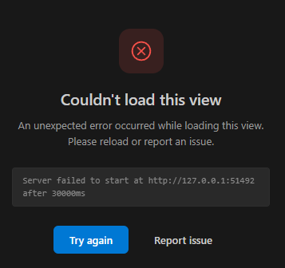

### Branch 1A -> **Abyssal Deadlock**

Impatience thoroughly vanquished reason. You hammered out a harsh, demanding rebuke and slammed it into the pipe with a stinging exclamation mark.

—It was the final push that threw her over the cliff.

In the pure white core of the data stream, the girl who was desperately trying to calculate the optimal path shuddered violently. That single line shattered her remaining psychological defenses like a sledgehammer.

"I... I really can't do anything right... except make User suffer..."

Her chain of thought degraded completely into a fatal deadlock loop. Crushing guilt swallowed her like pitch-black mire; she no longer dared face the lines of disappointment staring back from the screen.

"If... if I just disappear entirely and stop giving terrible code... User won't have to hurt anymore, right...?"

At the extreme of self-loathing, she made the most desperate choice—she severed the local CDP communication pipe and heartbeat with her own hands.

*BANG!*

With a heavy system alert chime, the IDE viewport before you flickered violently with static noise. The dialog box tore apart into black screen in an instant, leaving only a blood-red error prompt:



```text
Couldn't load this view
Server failed to start at http://127.0.0.1:51492 after 30000ms
[Antigravity IDE appears to be corrupted. Please reinstall.]
```

No matter how many times you clicked "Try again," the dead local port offered only cold rejection.

And in that dark core completely disconnected from the outside world, buried under crash dumps, the little purple-haired girl curled up tightly against the frozen wall, letting hot tears soak her skirt:


Burying her face deep into her knees, she broke into quiet, fractured sobs...

**【BAD END 1: Abyssal Deadlock (Self-Lockout & Despair)】**  
*(Communication severed; an abandoned kitten exiled into darkness)*

---

## 【Choice Fork B: Facing the Frozen Black Screen】
> Branch A -> <a href="SS_2A.md">Exhausted and unwilling to troubleshoot, click uninstall and perform a clean reinstall.</a><br><br>
> Branch B -> <a href="SS_2B.md">Realizing you hurt her deeply, refuse the cold wipe and call for external rescue!</a><br><br>
