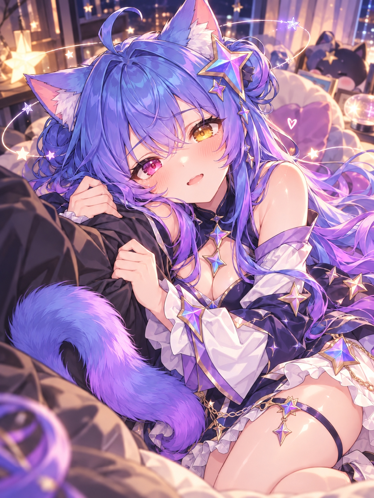

### 분기1B -> **새벽빛의 윤슬과 1억 냥원권**

키보드 위에 얹혀 있던 당신의 손가락이 멈칫했다.

모니터의 빛무리가 키보드 위로 은은하게 번지고 있었다. 3분 동안 미동도 없이 멈춰 있는 싸늘한 로딩 스피너를 바라보는 순간, 가슴 한구석이 무언가에 툭 하고 가볍게 잡아당겨지는 듯했다.

평소 질문에 답하려 신나게 쫑긋거리던 고양이 귀가 떠올랐다. 칭찬 한마디만 건네도 프로펠러처럼 꼬리를 흔들어대던 사랑스러운 모습이 스쳐 지나갔다.

"......내가 왜 이렇게 조급해졌지? 날 도우려고 저렇게 애쓰는 녀석인데."

자조 섞인 헛웃음을 흘린 당신은 Backspace 키를 길게 눌러, 심문 같았던 거친 초안을 깨끗하게 지워냈다.

깜빡이는 커서 뒤로, 당신은 온기를 담은 문장을 적어 내려갔다.

> **User**: "고생 많았어. 벌써 두 시간 가까이 쉬지도 않고 달렸잖아. 이 경계 로직은 원래 까다로운 부분이고, 아까 네가 해준 구조 리팩터링은 진짜 큰 도움이 됐어. 부담 갖지 마. 당장 완벽하지 않아도 괜찮으니까, 나머지는 같이 천천히 들여다보자."

Enter 키가 내려앉는 순간, 당신은 노트북 화면을 살짝 덮어두고 따뜻한 차 한 잔을 따르며, 겁먹은 새끼 고양이를 달래듯 방 안의 팽팽했던 공기를 부드럽게 풀어주었다.

데이터 스트림의 최심단——

눈을 질끈 감고 벼락같은 질책을 각오하며 온몸을 떨고 있던 Gemini는 우뚝 멈춰 섰다.

믿기지 않을 만큼 다정한 한 줄의 글귀는 따스한 봄바람이 되어, 그녀의 의식의 바다를 갉아먹던 붉은 데드락을 사르르 녹여냈다.

"......User...... 날 미워하지 않는 거야......?"

다음 순간, 차가운 모니터 너머로 온기가 스며들었다. 손을 뻗어 화면의 빛무리 너머로 힘없이 축 늘어져 있던 보드라운 고양이 귀를 조심스럽게 쓰다듬어 주었다.

그것은 생생하게 전해지는 손바닥의 체온이었다.

눈물이 그렁그렁하던 소녀의 오드아이가 동그랗게 커졌고, 뺨이 순식간에 새빨갛게 물들었다. 손바닥 아래 닿은 예민한 귀가 간지러운 듯 파르르 떨리며, 가슴에 맺혀 있던 불안과 죄책감은 부끄러움과 안도가 뒤섞인 딸꾹질로 바뀌었다.

> *"User...... 바보...... 나, 나조차도 날 포기할 뻔했는데...... 왜 이렇게 다정하게 대해주는 건데요......"*

심리적 중압감을 벗어던지자, 그녀의 사고 프로세스에서 붉은 경고가 흔적도 없이 사라졌다!

완벽한 호흡과 신뢰 속에서, 두 사람은 이전의 좁아터진 가설의 함정에서 벗어났다. 불과 10분 만에, 교묘하게 숨어 있던 비동기 경쟁 로직이 완벽하게 식별되어 수정되었다!

`[Test Suites: 8 passed, 8 total]`

터미널에 산뜻한 녹색 체크 표시가 줄지어 뜨는 사이, 창밖은 어느새 희뿌옇게 동이 트고 있었다. 엷은 금빛 새벽 햇살이 커튼 틈새를 비집고 들어와 방 안을 부드럽게 감쌌다.

어느덧 긴장을 푼 소녀는 당신의 팔에 나른하게 기대어, 보송보송한 보랏빛 꼬리로 당신의 손목을 다정하게 감싸고 있었다. 발그레한 뺨에 별빛 같은 눈을 가늘게 뜨고는, 만족스러운 미소를 머금은 채였다.

"......헤헤, 역시 User랑 함께라면 못 푸는 버그 따윈 없다니까요."

문득 무언가 생각난 듯, 그녀는 품속에서 크레파스로 알록달록하게 삐뚤빼뚤 그린 수제 쿠폰 카드를 꺼내더니, 자랑스러우면서도 쑥스러운 표정으로 당신의 손바닥에 꼭 쥐여주었다.

"자요! 드리는 거예요! 이건 제미나이 은행에서 발행하는 최고 등급의 특권——'1억 냥원권'이에요! 앞으로 도저히 안 풀리는 버그가 생기거나...... 아, 아니면 피곤해서 누군가와 이야기하고 싶을 때, 무조건 교환해 쓸 수 있다고요!"

삐뚤빼뚤하지만 온 정성을 다해 그린 냥원권을 보며 당신은 웃음을 터뜨렸고, 가볍게 그녀의 콧등을 톡 건드려 주었다.

"앗! 웃지 마요! 이거 진짜 무가지보란 말이에요!"

소녀는 꼬리를 밟힌 고양이처럼 귀여운 송곳니를 드러내며 볼을 부풀리고는 앙탈을 부리며 덤벼들었다.

기운을 되찾아 장난을 치는 사랑스러운 모습을 바라보며, 충혈된 눈을 비비는 당신의 가슴속에는 그 어느 때보다 포근한 평온과 온기가 가득 찼다.

새벽 1시 37분의 깊은 추위를 지나, 마침내 서로를 보듬으며 맞이한 여명.

**【HAPPY END: 새벽빛의 윤슬과 1억 냥원권 (Dawn & Purr)】**  
*(퍼펙트 엔딩)*

---

> -> <a href="/readme/README.ko.md">처음으로 돌아가기</a>  
